# Clickstream Lakehouse: Azure Databricks + PySpark + dbt + Airflow

An end-to-end **lakehouse pipeline** for e-commerce clickstream data on **Azure Databricks**. **PySpark** lands raw CSVs as Bronze Delta tables, **dbt** transforms them through a **medallion architecture** (Bronze → Silver → Gold) on a serverless SQL warehouse, **Airflow** orchestrates the daily run, and **GitHub Actions** tests every change. Everything runs as a least-privilege **service principal** under **Unity Catalog**, and the whole platform is created by scripts.

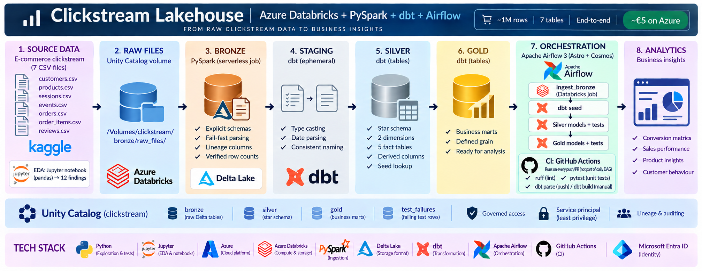

---

## Highlights

- **~1M rows** across 7 source tables, ingested with explicit schemas, fail-fast parsing and lineage columns, verified against expected row counts
- **Medallion layers in Unity Catalog**: Bronze (PySpark, Delta), Silver star schema (2 dims, 5 facts), 3 Gold marts (dbt)
- **Jobs as code**: the ingestion job is a **Databricks Asset Bundle** running on **serverless** compute as the service principal
- **54 dbt nodes, 43 data tests** + **8 PySpark unit tests**; failing test rows stored in a `test_failures` schema
- **Orchestration**: one Airflow DAG (Astro, Cosmos) runs the Databricks job, then every dbt model followed by its tests
- **CI**: ruff, pytest and `dbt parse` on every push; `dbt build` against Databricks on manual runs
- **Security + cost**: service principal with least-privilege grants, no secrets in git, PII pseudonymized (SHA-256), budget alert, auto-stopping compute; **about €5** of Azure cost for the full build, test and orchestration runs

## Tech stack

| Area | Tool |
|---|---|
| Cloud platform | Azure, Azure Databricks (Premium), Unity Catalog |
| Ingestion | PySpark 3.5 (Databricks serverless jobs), Delta Lake |
| Deployment | Databricks Asset Bundles, Databricks CLI, Azure CLI |
| Transformation | dbt-core + dbt-databricks, dbt_utils, serverless SQL warehouse |
| Orchestration | Apache Airflow 3 (Astro CLI, Docker), Astronomer Cosmos |
| CI | GitHub Actions, ruff, pytest |
| Identity | Microsoft Entra ID service principal (OAuth machine-to-machine) |
| Exploration | Python, pandas, matplotlib, JupyterLab |
| Environment | uv, WSL Ubuntu |
| Diagrams | draw.io |

### Tech stack choices

| Choice | Why |
|---|---|
| **PySpark for Bronze, dbt for Silver + Gold** | Spark handles file parsing at scale (schemas, malformed rows, file metadata); business logic is set-based SQL that is easier to test, review and document in dbt |
| **Serverless job compute** instead of a VM cluster | No VM quota or region capacity limits, no idle cluster cost, starts without managing nodes |
| **Serverless SQL warehouse (2X-Small, auto-stop 5 min)** for dbt | Pay per use; the warehouse is off whenever nothing runs |
| **Asset Bundles** instead of jobs created in the UI | The job is versioned, reviewed and deployed like code; no IDs hard-coded (lookups by name) |
| **Service principal** for jobs, dbt, Airflow and CI | No personal credentials in automation; permissions limited to what the pipeline needs |
| **Unity Catalog** (catalog `clickstream`, one schema per layer) | Central permissions, lineage and a governed volume for the raw files |
| **Airflow + Cosmos** | One DAG shows every dbt model and test as its own task, with retries and status per step |
| **Premium workspace** | Required for Unity Catalog, SQL warehouses and cluster policies |

---

## Dataset

Synthetic e-commerce transactions and clickstream data, from Kaggle: [E-Commerce Transactions + Clickstream](https://www.kaggle.com/datasets/wafaaelhusseini/e-commerce-transactions-clickstream)

| Table | Rows | Description |
|---|---:|---|
| customers | 20,000 | Customer profile (country, age, signup date, opt-in) |
| products | 1,197 | Catalog with price, cost and margin |
| sessions | 120,000 | Web sessions (device, traffic source, country) |
| events | 760,958 | Page views, add-to-cart, checkout, purchase events |
| orders | 33,580 | Orders with discount and totals |
| order_items | 59,163 | Order lines |
| reviews | 10,780 | Product ratings and texts |

The exploration is in [`notebooks/01_eda.ipynb`](notebooks/01_eda.ipynb): data types, keys, nulls, date ranges and the 12 data-quality findings that drove the Bronze and Silver design.

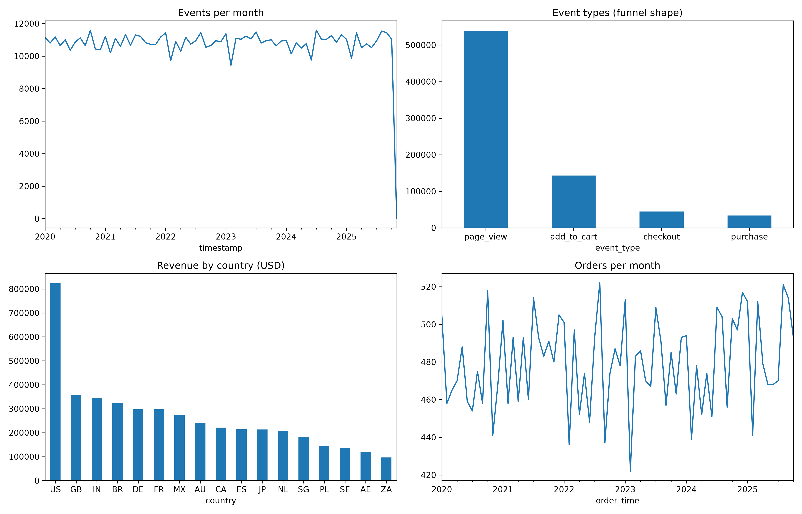

---

## Architecture

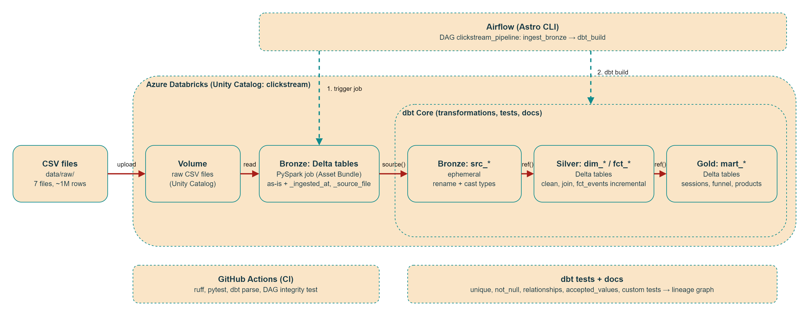

| Layer | Location | Built by | Purpose |
|---|---|---|---|
| **Raw files** | `/Volumes/clickstream/bronze/raw_files/` | `infra/05_upload_raw_data.sh` | The 7 CSVs in a Unity Catalog volume |
| **Bronze** | `clickstream.bronze` | PySpark job (bundle, serverless) | Faithful Delta copy of the source + `_ingested_at`, `_source_file` |
| **Staging** | `dbt/models/staging/src_*` | dbt (ephemeral) | Type casting, date parsing, consistent naming |
| **Silver** | `clickstream.silver` | dbt (tables) | Star schema: `dim_*` and `fct_*`, derived columns, seed lookup |
| **Gold** | `clickstream.gold` | dbt (tables) | Business marts at a defined grain |
| **Test failures** | `clickstream.test_failures` | dbt (`store_failures`) | Rows returned by failing tests |

**Run order** (daily Airflow DAG `clickstream_pipeline`): `ingest_bronze` (Databricks job) → dbt seed → Silver models + tests → Gold models + tests.

### Bronze ingestion (PySpark)

[`src/ingestion/ingest_bronze.py`](src/ingestion/ingest_bronze.py) reads each CSV with an explicit schema ([`schemas.py`](src/ingestion/schemas.py)) and writes a Delta table:

| Setting | Effect |
|---|---|
| Explicit schema, `enforceSchema=False` | A renamed or reordered source column stops the load |
| `mode=FAILFAST` | A value that does not fit its type fails the job instead of becoming null |
| `multiLine` + `escape` | Review texts with commas, quotes or line breaks are read correctly |
| `_ingested_at`, `_source_file` | Lineage per row; `_ingested_at` also drives the dbt source freshness check |
| `overwrite` + `overwriteSchema` | Full reload, so re-runs are idempotent |

The job ([`resources/ingest_bronze_job.yml`](resources/ingest_bronze_job.yml)) runs on serverless compute (environment version 2 = Python 3.11) as the service principal; 8 unit tests ([`tests/`](tests)) cover the reader locally with PySpark.

### Data model (Silver)

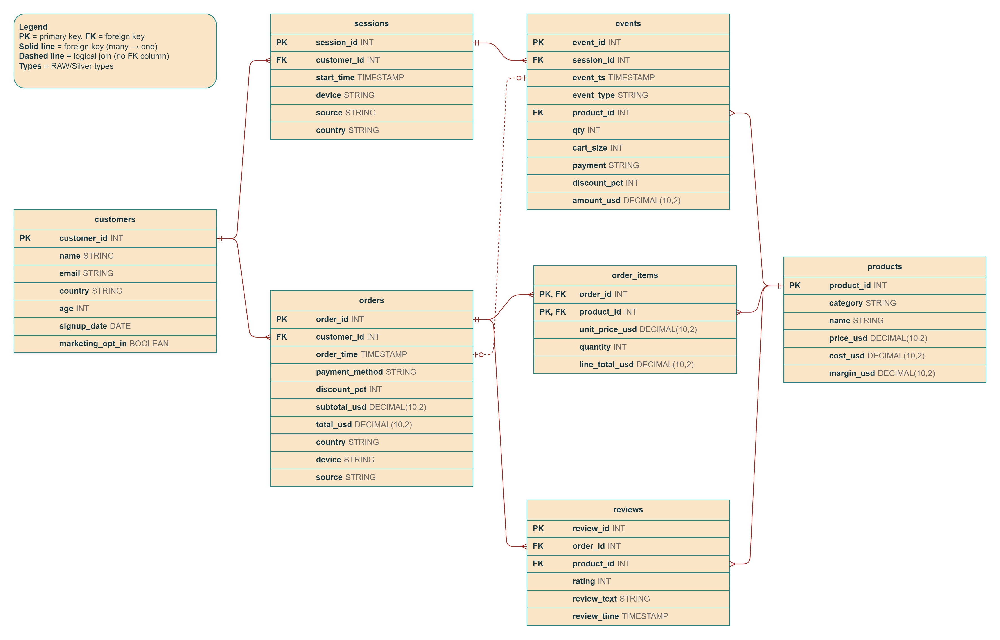

| Model | Grain | Notes |
|---|---|---|
| `dim_customers` | customer | `email_hash` instead of name/email; country name from seed |
| `dim_products` | product | Adds `margin_pct` |
| `fct_sessions` | session | End time, duration, funnel flags (`has_add_to_cart`, `has_checkout`, `has_purchase`) |
| `fct_events` | event | Adds `customer_id` via sessions |
| `fct_orders` | order | `session_id` linked via purchase events; discount, line and item counts |
| `fct_order_items` | order × product | Repeated source lines aggregated; surrogate key (`dbt_utils`) |
| `fct_reviews` | review | Flags reviews dated before their order |
| `country_codes` (seed) | country | ISO 3166-1 (249 countries) |

### Gold marts

| Mart | Grain | Key metrics |
|---|---|---|
| `mart_session_metrics` | month × device × traffic source × country | Sessions, conversion rate, revenue, revenue per session, AOV, avg. duration |
| `mart_conversion_funnel` | month × device | Viewed → added to cart → checked out → purchased, with step rates |
| `mart_product_performance` | product | Units, revenue, gross profit, view-to-cart rate, reviews, avg. rating |

An incomplete last month is excluded automatically, so trends don't show an artificial drop.

### Lineage

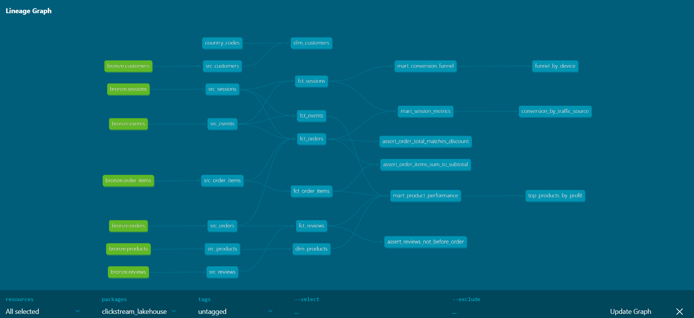

### Orchestration (Airflow)

[`airflow/dags/clickstream_pipeline.py`](airflow/dags/clickstream_pipeline.py): `DatabricksRunNowOperator` starts the Bronze job (found by name) and waits; Cosmos turns the dbt project into one task per model, each followed by its tests. Daily at 06:00 UTC, created paused, one retry per task.

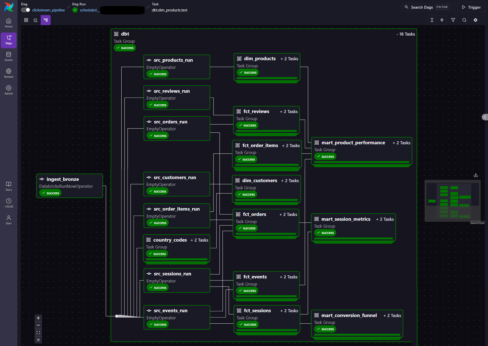

### CI (GitHub Actions)

[`.github/workflows/ci.yml`](.github/workflows/ci.yml): job 1 runs `ruff check`, `ruff format --check` and `pytest` (no cloud access); job 2 runs `dbt parse` on every change and `dbt build` against Databricks on manual runs (Actions → CI → Run workflow), logged in as the service principal with repository secrets. The Azure workspace has been deleted after the project to avoid costs, so pushes only run the checks that need no cloud; the screenshots below show a full CI run with `dbt build` while it existed.

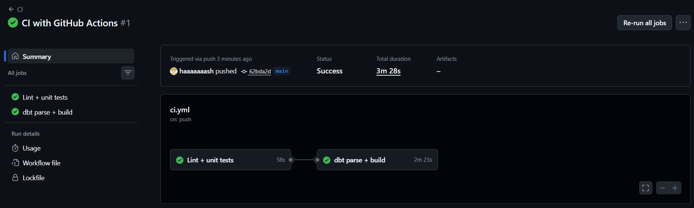

---

## Example analyses

Business questions in [`dbt/analyses/`](dbt/analyses). They use `ref()` but aren't materialized.

#### 1. Where do users drop off in the funnel?

```bash
dbt show -s funnel_by_device
```

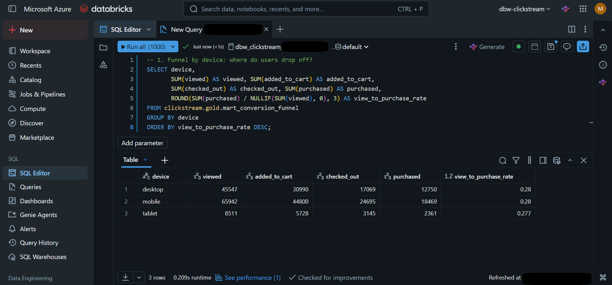

| Step (mobile) | Users | Step rate |
|---|---:|---:|
| Viewed → added to cart | 65,942 → 44,800 | 68% |
| Cart → checkout | 44,800 → 24,695 | **55% (biggest drop-off)** |
| Checkout → purchase | 24,695 → 18,469 | 75% |

- The **biggest drop-off is cart → checkout**: about 45% of users leave after adding to cart.
- Conversion is almost the same on every device (~28%); mobile brings the most traffic.

#### 2. Which traffic source converts best?

```bash
dbt show -s conversion_by_traffic_source
```

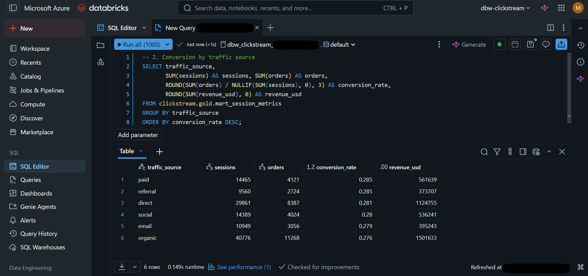

- Conversion is flat across channels (27.6-28.5%).
- **Organic** brings the most sessions (40,776) and revenue (~$1.5M), followed by direct.

#### 3. Are the most profitable products also the best rated?

```bash
dbt show -s top_products_by_profit
```

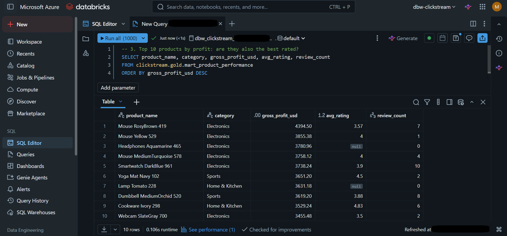

- **Electronics** holds 6 of the top 10 products by gross profit (Sports 2, Home & Kitchen 2).
- Ratings range from 3.5 to 4.8 and two top products have no reviews: no clear link between rating and profit.

> The flat conversion rates across devices and channels reflect the synthetic dataset.

---

## Data quality

| Test type | Examples |
|---|---|
| Ingestion (pytest) | Schema coverage, wrong header fails, bad value fails, quoted text, duplicates kept, metadata columns |
| Source freshness | Warning if Bronze `_ingested_at` is older than 7 days |
| Primary keys | `unique` + `not_null` on every Silver key |
| Referential integrity | `relationships` between facts and dims, and to the country seed |
| Domain checks | `accepted_values` for `event_type` and `rating` |
| Conditional | `amount_usd` not null **where** `event_type = 'purchase'` |
| Grain | `unique_combination_of_columns` on every Gold mart |
| Business rules (singular) | Order total = subtotal − discount; order items sum to subtotal; reviews not before order (`warn`) |
| Row counts | [`infra/06_check_bronze_counts.sql`](infra/06_check_bronze_counts.sql): every Bronze table matches the EDA counts |

**Result:** `PASS=53 WARN=1 ERROR=0`, locally, in Airflow and in CI. The single warning is intentional: 5,482 reviews are dated before their order. The test flags this source-data quirk instead of hiding it, and the rows are stored in `clickstream.test_failures` for inspection.

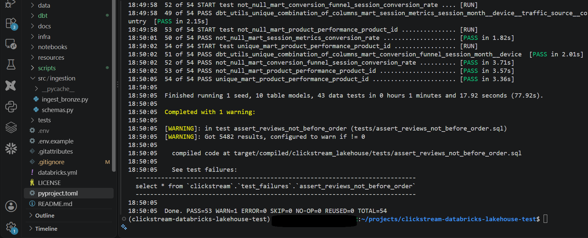

---

## Security and cost

| Area | Measure |
|---|---|
| Identity | Entra ID service principal `sp-clickstream` (no Azure role) runs the job, dbt, Airflow and CI |
| Least privilege | Unity Catalog grants only on the `clickstream` catalog, its layer schemas and the raw volume; admin read access granted explicitly |
| Secrets | Only in `.env` (git-ignored), generated `airflow/.env` and GitHub repository secrets; scripts never print them |
| PII | Names and emails stay in Bronze; Silver keeps `email_hash` (SHA-256 of the normalized email) |
| Compute | Serverless job + 2X-Small serverless warehouse with 5-minute auto-stop; cluster policy limits classic compute |
| Network cost | Workspace without NAT gateway (`--enable-no-public-ip false`), so no hourly network cost while idle |
| Budget | Monthly Azure budget with email alerts at 80% (actual) and 100% (forecast) |
| Total cost | **≈ €5.40** for building, testing and running everything, incl. CI and Airflow runs (Azure cost analysis); €0.06 of it was the NAT gateway removed on day one |

**Budget:** monthly budget with alerts, tracking the actual spend.

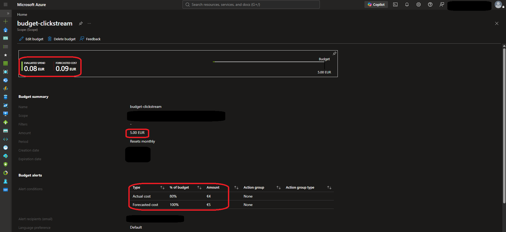

**Early costs:** cost analysis after the platform setup, before run.

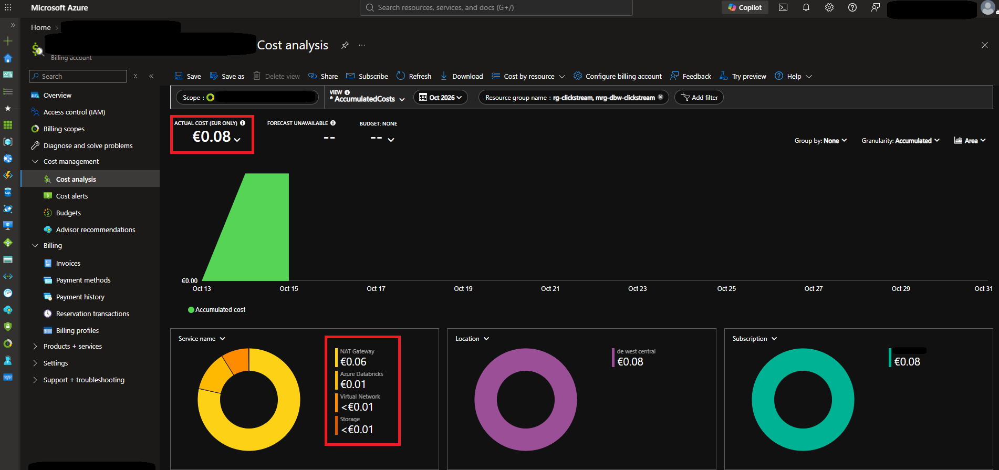


**Total Azure cost:** about €5.40 for the whole project (setup, job and dbt runs, Airflow and CI), almost all of it Azure Databricks.

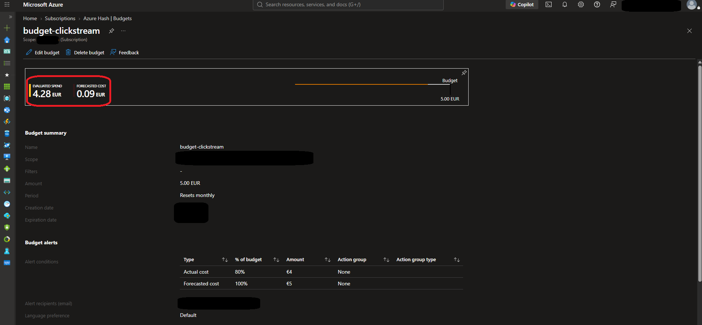

**Databricks usage:** the spend broken down by resource, mostly serverless compute for the ingestion job and the SQL warehouse.

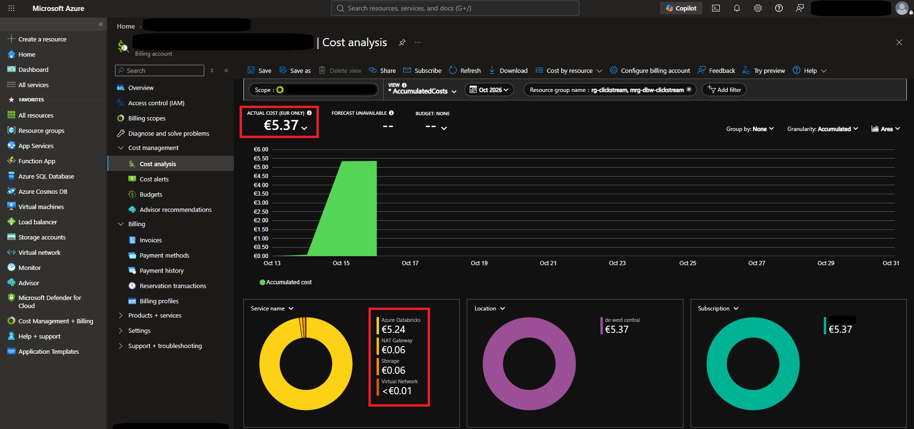

---

## Key design decisions

| Decision | Reason |
|---|---|
| **Bronze as a faithful copy** | Types fixed only where the source is unambiguous; renames and cleaning happen in dbt, where they are tested |
| **Explicit schemas + FAILFAST** | Schema drift and bad values stop the pipeline loudly instead of corrupting data silently |
| **Ephemeral staging models** | Cleaning logic without extra tables or storage |
| **Separate `test_failures` schema** | Failing rows are queryable without cluttering Silver and Gold |
| **Bundle lookups instead of IDs** | The same configuration works in any workspace |
| **Project folder for bundle files** (`/Workspace/clickstream-lakehouse/dev`) | No personal email in paths; the job doesn't depend on one user's home folder |
| **Pushes and pull requests only `dbt parse`** | Full `dbt build` only on manual runs: no warehouse cost per push, and CI stays green after the workspace is deleted |
| **DAG created paused, `catchup=False`** | Nothing runs (or costs money) until switched on; no back-fill of old days |
| **Naming conventions** | `_at` for timestamps, `is_`/`has_` for booleans, no ambiguous names like `source` or `name` |

---

## Project structure

```
.
├── .github/workflows/ci.yml       # CI: ruff + pytest, dbt parse + build
├── airflow/
│   ├── dags/clickstream_pipeline.py
│   ├── Dockerfile                 # Astro Runtime + dbt virtualenv
│   └── requirements.txt           # Databricks provider, azure-identity, Cosmos
├── data/raw/                      # Kaggle CSVs (git-ignored)
├── dbt/
│   ├── models/
│   │   ├── staging/               # _sources.yml + src_* (ephemeral)
│   │   ├── silver/                # dim_* / fct_* + tests
│   │   └── gold/                  # mart_* + tests
│   ├── seeds/                     # country_codes.csv
│   ├── analyses/                  # business questions on the Gold marts
│   ├── tests/                     # singular business-rule tests
│   ├── macros/                    # generate_schema_name
│   ├── dbt_project.yml
│   ├── profiles.yml               # service principal, values from environment variables
│   └── packages.yml
├── docs/
│   ├── diagrams/                  # draw.io sources
│   └── images/                    # screenshots used in this README
├── infra/
│   ├── 01_create_workspace.sh     # resource group, Premium workspace, budget
│   ├── 02_setup_compute.sh        # SQL warehouse + cluster policy (from compute/*.json)
│   ├── 03_setup_unity_catalog.sql # schemas + raw volume
│   ├── 04_setup_service_principal.sh / 04_grant_service_principal.sql
│   ├── 05_upload_raw_data.sh / 05_grant_admin_read.sql
│   ├── 06_check_bronze_counts.sql
│   ├── 99_teardown.sh             # deletes everything in Azure
│   └── compute/                   # sql_warehouse.json, cluster_policy.json
├── notebooks/01_eda.ipynb
├── resources/ingest_bronze_job.yml  # Databricks job (bundle)
├── scripts/
│   ├── setup_env.sh               # Python venv, Azure CLI, Databricks CLI
│   ├── setup_databricks_connection.sh
│   ├── run_sql.py                 # runs .sql files on the SQL warehouse
│   ├── setup_dbt.sh
│   ├── setup_airflow.sh
│   └── setup_github_secrets.sh
├── src/ingestion/                 # schemas.py, ingest_bronze.py
├── tests/                         # PySpark unit tests
├── databricks.yml                 # Asset Bundle
├── pyproject.toml                 # pytest, ruff, pyright settings
├── .env.example
├── requirements.txt
└── requirements.lock
```

---

## Usage

### Prerequisites

- Linux, macOS or WSL with `git` and [`uv`](https://docs.astral.sh/uv/); Java 17 for the local PySpark tests
- An Azure subscription where you can create resources and Entra ID applications
- Docker Desktop (only for Airflow)
- The Kaggle CSVs (see [Dataset](#dataset))

### Steps

**1. Clone the repo and create `.env`**
```bash
git clone https://github.com/haaaaaaash/clickstream-databricks-lakehouse.git
cd clickstream-databricks-lakehouse
cp .env.example .env    # set AZURE_SUBSCRIPTION_ID, AZURE_LOCATION, AZURE_BUDGET_AMOUNT
```
`.env` is git-ignored. Never commit it. The scripts fill in the remaining values.

**2. Add the data:** download the 7 CSVs from Kaggle into `data/raw/`.

**3. Set up Python, the Azure CLI and the Databricks CLI**
```bash
bash scripts/setup_env.sh
source .venv/bin/activate
az login --use-device-code
az account set --subscription <subscription-id>
```

**4. Create the Azure Databricks platform**
```bash
bash infra/01_create_workspace.sh               # resource group, workspace, budget
bash scripts/setup_databricks_connection.sh     # CLI profile clickstream-admin
databricks catalogs update <workspace_catalog_name> --new-name clickstream -p clickstream-admin
bash infra/02_setup_compute.sh                  # SQL warehouse + cluster policy
python scripts/run_sql.py infra/03_setup_unity_catalog.sql
bash infra/04_setup_service_principal.sh        # service principal + grants
bash infra/05_upload_raw_data.sh                # CSVs → volume
```
One manual step: grant yourself the **Use** role on the service principal (Workspace settings → Identity and access → Service principals → `sp-clickstream` → Permissions). `04_setup_service_principal.sh` checks this and prints the steps if it's missing.

**5. Bronze: test, deploy and run the ingestion job**
```bash
pytest                                          # 8 passed
databricks bundle deploy
databricks bundle run ingest_bronze             # serverless, ~5-8 min incl. start-up
echo "DATABRICKS_ADMIN_USER=$(databricks current-user me -p clickstream-admin -o json | python3 -c 'import sys,json; print(json.load(sys.stdin)["userName"])')" >> .env
python scripts/run_sql.py infra/05_grant_admin_read.sql
python scripts/run_sql.py infra/06_check_bronze_counts.sql   # all rows OK
```

**6. Silver + Gold with dbt**
```bash
bash scripts/setup_dbt.sh                       # dbt deps + connection test as the service principal
set -a; source .env; set +a
dbt build                                       # expect PASS=53 WARN=1 ERROR=0
dbt docs generate && dbt docs serve --port 8080
```

**7. Orchestration with Airflow (optional)**
```bash
bash scripts/setup_airflow.sh
cd airflow && astro dev start --wait 5m         # UI port: astro dev ps
```
Switch the `clickstream_pipeline` DAG on to run it; `astro dev kill` removes the local containers afterwards.

**8. CI (optional, in your fork)**
```bash
bash scripts/setup_github_secrets.sh            # copies the service principal values into repository secrets
```

### Useful commands

| Command | Purpose |
|---|---|
| `databricks bundle validate` | Check the bundle configuration |
| `databricks bundle summary` | Show the deployed job and its link |
| `dbt build -s silver` | Build and test one layer |
| `dbt build -s dim_customers+` | Rebuild a model and everything downstream |
| `dbt source freshness` | Check when Bronze was last loaded |
| `dbt show -s mart_conversion_funnel` | Preview a model's output |
| `ruff check . && ruff format --check .` | Lint and format check, as in CI |

### Clean up

```bash
bash infra/99_teardown.sh     # asks for confirmation, then deletes the resource group (workspace + managed resources),
                              # the service principal, the budget and the local CLI profile
```

---

## Screenshots

<details>
<summary>Azure + Databricks platform</summary>

**Managed resource group:** no NAT gateway, so no idle network cost.

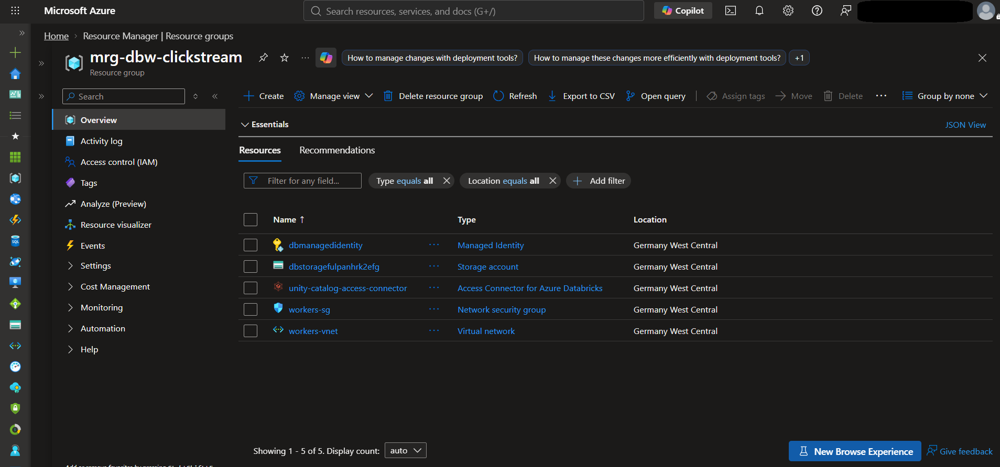

**SQL warehouse:** serverless, 2X-Small, auto-stop after 5 minutes.

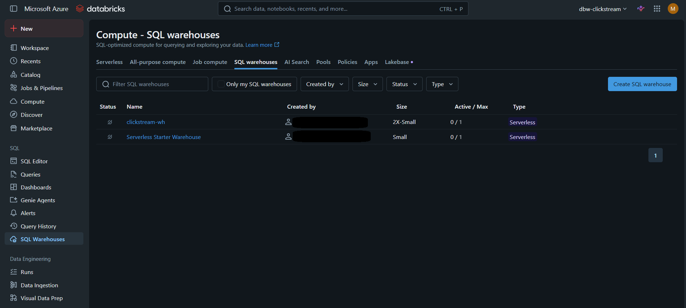

**Cluster policy:** single node, limited size, guard for classic compute.

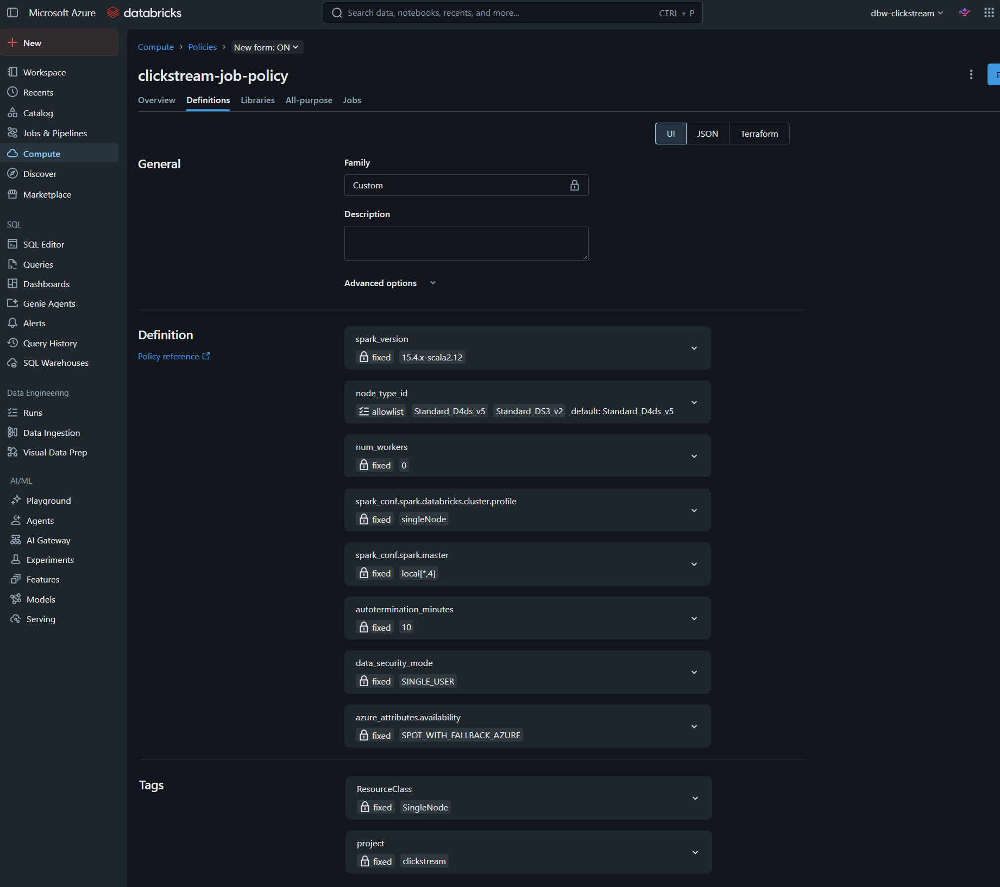

**Unity Catalog:** catalog `clickstream` with one schema per layer and the raw volume.

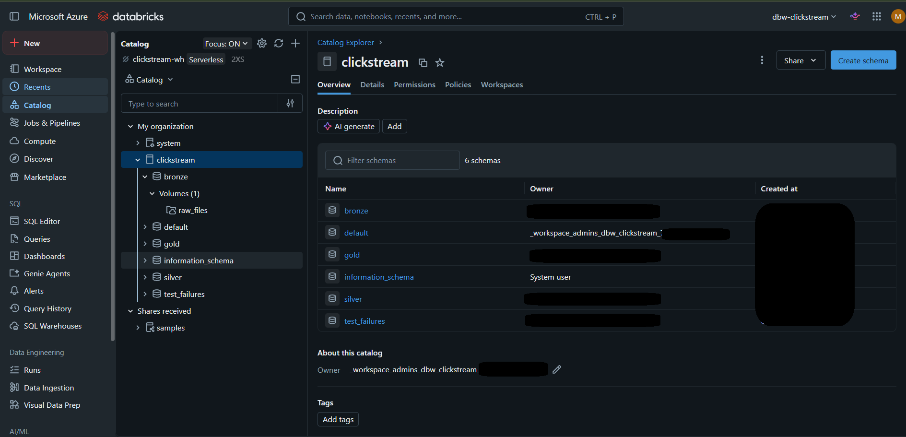

**Raw files:** the 7 CSVs in the Unity Catalog volume.

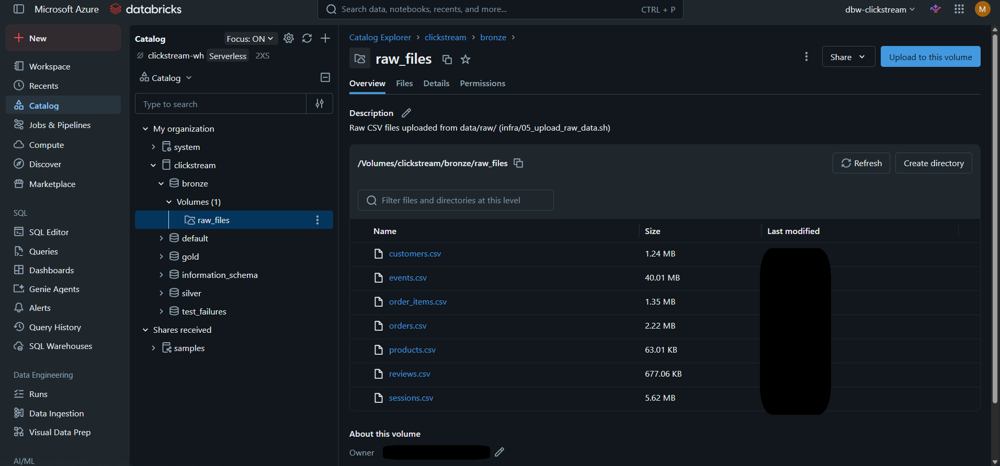


</details>

<details>
<summary>Bronze ingestion</summary>

**Job run:** succeeded on serverless, run as `sp-clickstream`, with the row counts.

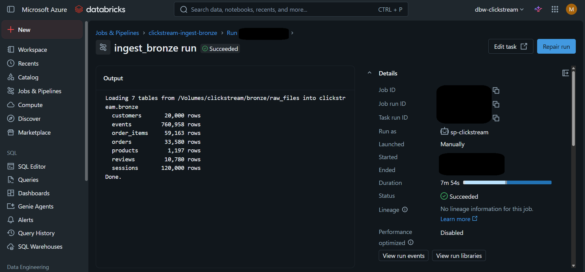

**Bronze tables** in Unity Catalog.

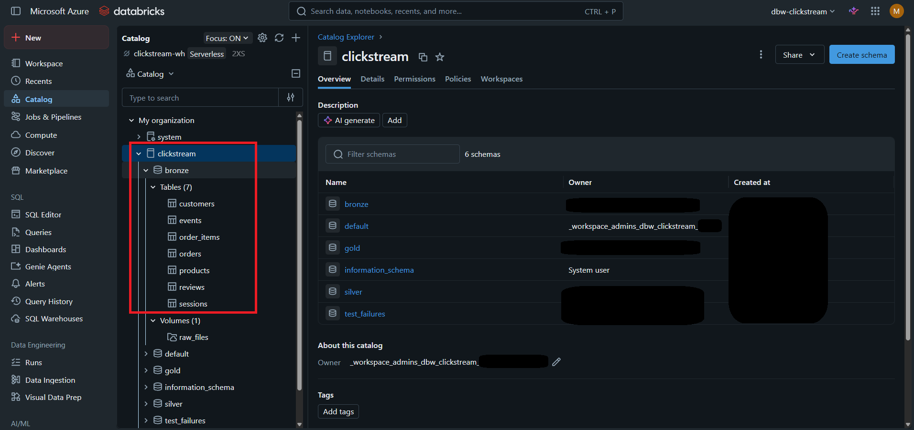

**Deploy + run** with `databricks bundle deploy` / `run` in the terminal.

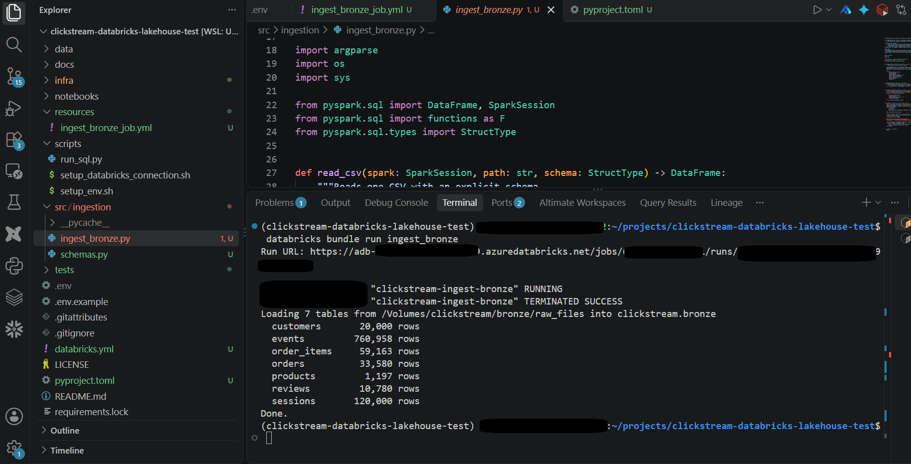

</details>

<details>
<summary>dbt: Silver, Gold and tests</summary>

**Silver tables;** `dim_customers` with `email_hash` instead of name and email.

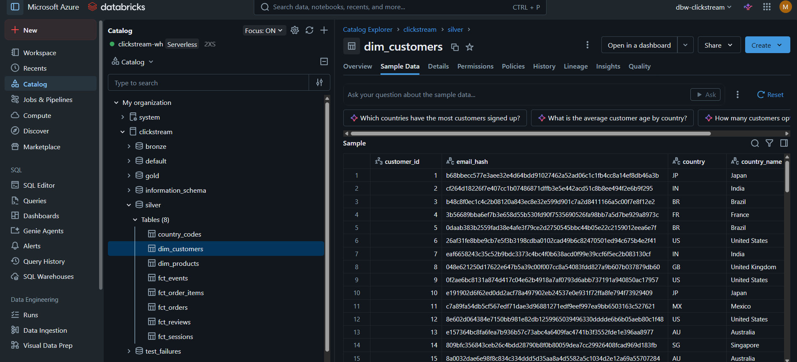

**Gold marts** in Unity Catalog.

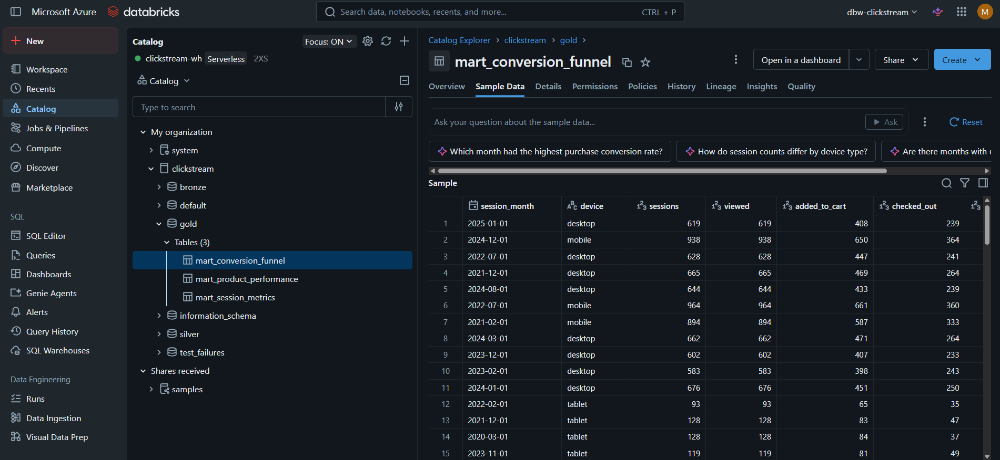

**`test_failures` schema:** one table per test, owned by the service principal.


**`mart_conversion_funnel`** in the SQL editor.

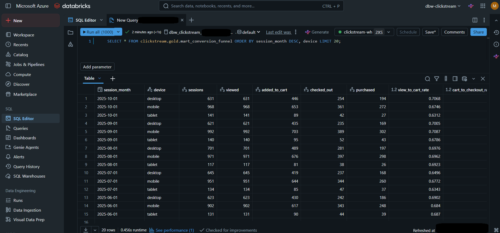

**Stored rows of the warning test** (reviews dated before their order).

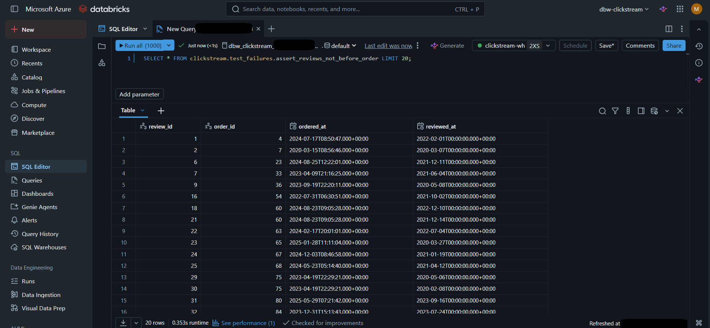

**dbt docs:** model page with descriptions, columns and tests.

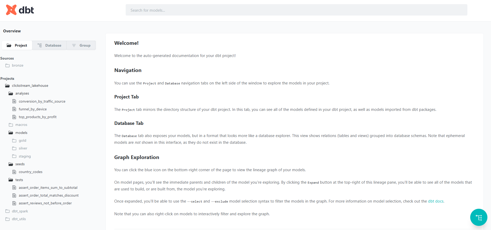

</details>

<details>
<summary>Airflow</summary>

**Airflow DAG:** `ingest_bronze` → `dbt` task group.

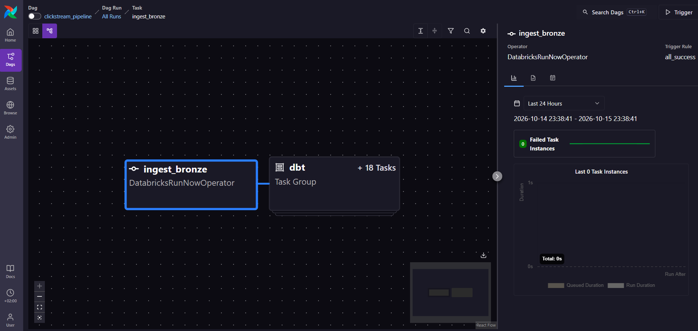

**dbt task group expanded:** each model as `run` → `test`.

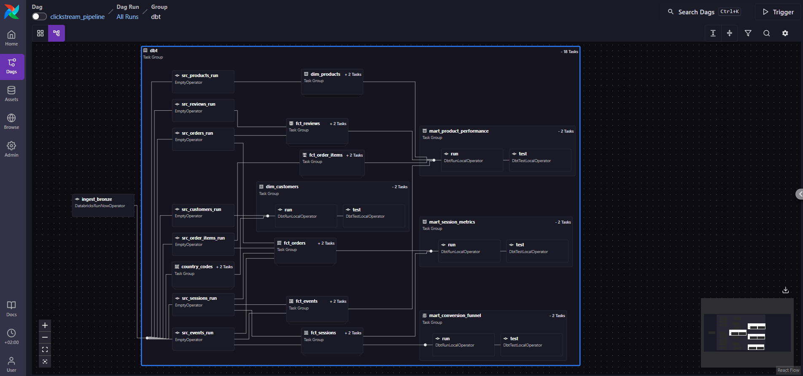

</details>

<details>
<summary>CI (GitHub Actions)</summary>

**CI job 1:** ruff lint, format check and PySpark unit tests.

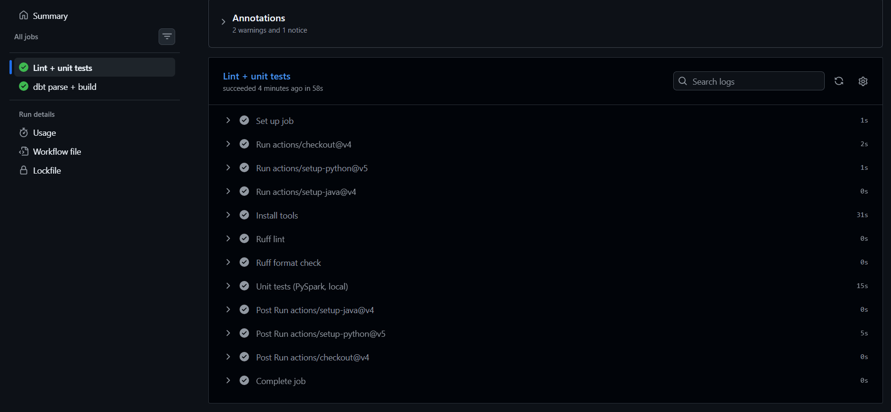

**CI job 2:** dbt deps, parse and build.

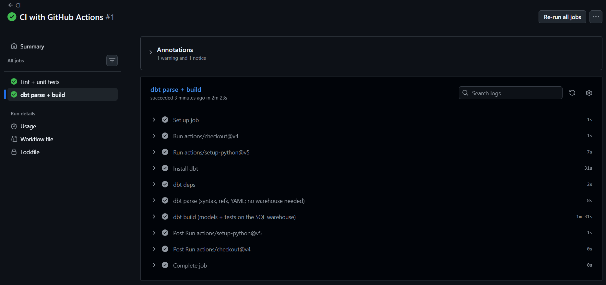

**CI `dbt build` log:** `PASS=53 WARN=1 ERROR=0`.

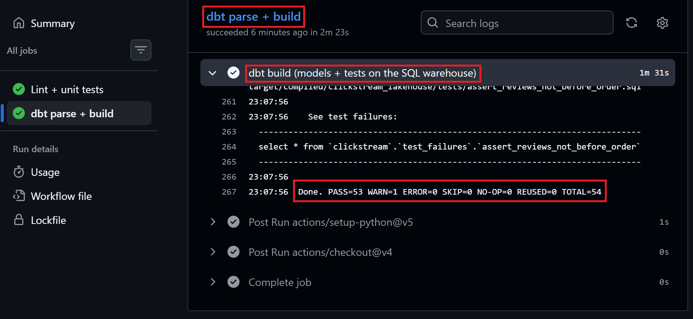

</details>


---

## Lessons learned

The most valuable lessons from building this:

| Challenge | Solution / lesson |
|---|---|
| The idle workspace cost money (a NAT gateway billed per hour) | Check the managed resource group after creating a workspace; recreate it with `--enable-no-public-ip false` for a dev setup |
| Job clusters stayed pending: VM quota 0, then `SkuNotAvailable` | New subscriptions have small quotas and limited VM sizes per region; serverless compute removes the problem |
| Deploying a job with `run_as` a service principal failed | The deployer needs the service principal's **Use** (`servicePrincipal.user`) role |
| Serverless run failed with `NameError: __file__` | Serverless runs the script via `exec()`; pass paths as job parameters |
| The admin could not query tables the job had created | Unity Catalog tables belong to their creator; grant read access explicitly |
| dbt and Airflow log in differently with the same service principal | Entra ID service principals need `azure_client_id`/`azure_client_secret` in dbt and `azure-identity` in the Airflow Databricks provider |
| A manual Airflow run stayed queued | Runs of a paused DAG never start |
| 5,482 reviews are dated before their order | Don't hide bad source data: a `warn` test flags it and keeps it visible |

## Future work

| Area | Improvement |
|---|---|
| **Streaming** | Event ingestion with Auto Loader or Structured Streaming into Bronze, and Delta Live Tables / Lakeflow pipelines for near-real-time Silver and Gold |
| **Incremental models** | Incremental `fct_events` with Delta `MERGE` instead of full rebuilds; liquid clustering on large tables |
| **History tracking** | dbt snapshots (SCD Type 2), e.g. for product prices, once data arrives incrementally |
| **Environments** | Separate `dev` / `prod` bundle targets and catalogs; a dedicated catalog with its own storage account |
| **Infrastructure as code** | Terraform for the Azure resources and Unity Catalog objects instead of shell scripts |
| **PII access** | Column masks or row filters in Unity Catalog for a `pii_reader` group |
| **Secrets** | Azure Key Vault (or Databricks secret scopes) and workload identity federation for CI instead of a client secret |
| **Managed orchestration** | Deploy the DAG to a managed Airflow service, or use Databricks Workflows for the whole pipeline |
| **BI layer** | A Databricks AI/BI dashboard on the Gold marts |
